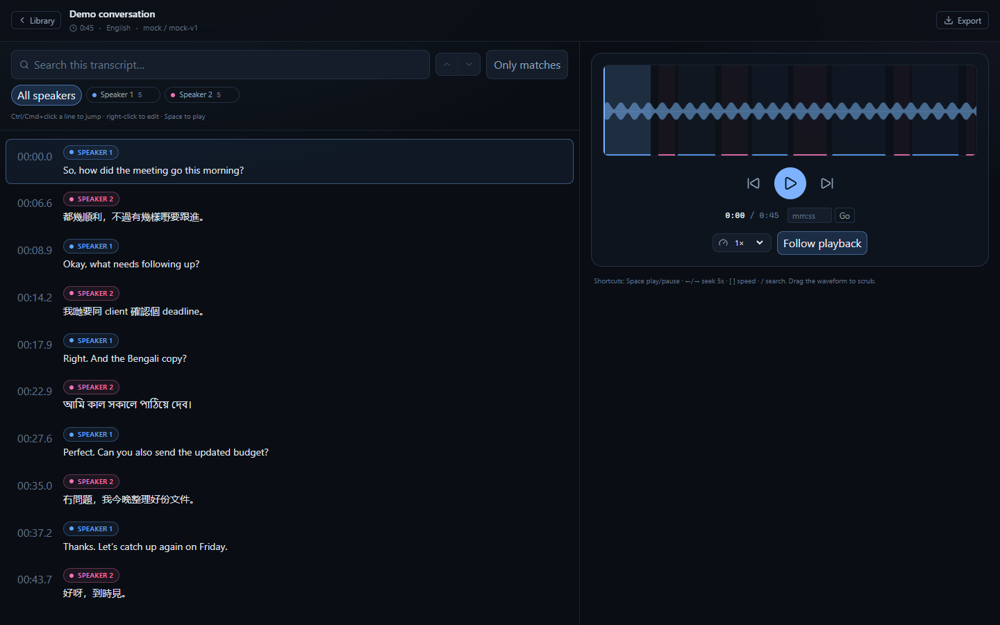

# Transcriber

A local-only web app for long conversations: upload an audio file, transcribe it with speaker
labels, then read and listen side by side. Built for Cantonese, English, Bengali, and code-switched
audio where no single model wins everywhere.



## Quick start

```bash
npm install
npm run dev
```

Open <http://127.0.0.1:3000>. Without an API key the app runs in **offline mock mode** — it produces a
synthetic two-speaker conversation so you can try the whole UI without spending anything.

```bash
npm run fixture   # create a 45-second demo conversation in the library
```

## Real transcription

Create `.env.local`:

```bash
ELEVENLABS_API_KEY=sk_...
# optional; leave unset to auto-select Scribe when the key is present
STT_PROVIDER=elevenlabs
```

Restart `npm run dev`. The engine picker on the upload page now defaults to
**ElevenLabs Scribe v2** (~$0.22/hour of audio).

### MAI-Transcribe-2 via OpenRouter (best for trilingual code-switching)

```bash
OPENROUTER_API_KEY=sk-or-...
OPENROUTER_MODEL=microsoft/mai-transcribe-2
STT_PROVIDER=openrouter   # optional: make MAI the default engine
```

- MAI-Transcribe-2 supports 60 languages including Cantonese (`yue`), automatic language
  identification, mid-speech code-switching, speaker diarization, and word timestamps.
- OpenRouter enables diarization through `provider.options.azure.diarization.enabled`; the app sends
  this automatically for MAI.
- ~$0.10/audio-hour. OpenRouter requires a **$0.50 minimum account balance for audio requests**.
- OpenRouter's upstream timeout is 60 seconds and the request cap is 25 MB. The app transcodes M4A
  (which Azure rejects) and oversized files to mono MP3 automatically.
- Switch back to `google/gemini-3.5-transcribe` by changing `OPENROUTER_MODEL`; note that Gemini's
  OpenRouter endpoint does not expose diarization.

### Why Scribe v2

| Provider | Cantonese | Bengali | Diarization | Word timestamps | Long files | Cost/hr |
|---|---|---|---|---|---|---|
| **MAI-Transcribe-2** (OpenRouter) | `yue`, code-switching | 60 languages | yes (Azure endpoint) | yes | ~1 h | ~$0.10 |
| **ElevenLabs Scribe v2** | strongest commercial claim | supported | 32 speakers | yes | ~10 h | ~$0.22 |
| Soniox `stt-async-v5` (stub) | `yue` unconfirmed | `bn` confirmed | yes | yes | 5 h | ~$0.10 |
| Azure Speech (stub) | native `zh-HK` | `bn-IN` | yes | yes | batch | ~$1.00 |
| Deepgram Nova-3 | `zh-HK`, weaker | listed | yes | yes | yes | ~$0.26 |
| OpenAI `gpt-4o-transcribe-diarize` | decent | unclear | yes | segment only | ~23 min cap | ~$0.36 |

Vendor WER claims are contested, so the choice is easy to re-test on your own audio:

```bash
npm run eval -- path/to/clip.wav --providers=elevenlabs,mock --language=yue --reference=clip.txt
```

The adapters live in [`lib/providers/`](lib/providers/). Soniox and Azure are deliberate stubs —
implement `transcribe()` and add the key to enable them. Soniox is roughly half the price and handles
mid-sentence code-switching, but its Cantonese support is unconfirmed; Azure is the safer Bengali
fallback.

The optional local Qwen3-ASR + pyannote sidecar in [`sidecar/`](sidecar/) is experimental. On this
machine's 4 GB GPU it was too slow for meetings and normalized Cantonese; MAI-Transcribe-2 is the
recommended engine for trilingual Cantonese/Mandarin/English audio.

### Language notes

- Cantonese uses Scribe's `yue` code, not `zh-HK`.
- `auto` is the default and works for most single-language files. For heavily code-switched
  Cantonese/English audio, try `yue` explicitly and compare.
- Some ASR models emit **Standard Written Chinese** for spoken Cantonese. If that happens, search for
  the spoken particles (唔, 嘅, 咗) will miss. The raw provider response is kept in
  `.data/library/{id}/raw.json` so a post-processing pass can be added without re-billing.
- The language list in [`lib/languages.ts`](lib/languages.ts) is the extension point.

## What the explorer does

- Search within the transcript, with match counts, next/previous, and an “Only matches” filter.
- Filter by speaker with colour-coded chips; rename speakers in place.
- Click a timestamp, or **Ctrl/Cmd+click a line**, to jump the audio there and play.
- Drag the waveform or use the scrubber; the transcript follows and highlights the current line.
- Playback speed 0.5×–3× (pitch-preserving), jump-to-time input, follow-playback toggle.
- **Re-transcribe with another engine or language** from the header. The previous transcript stays
  readable (read-only) while the run proceeds and is kept under **Versions**, where any version can
  be downloaded or restored. Restoring archives the current version first, so it is reversible.
- **Right-click a line to edit it in place.** Enter saves, Shift+Enter adds a newline, Esc cancels.
  IME composition is respected, so committing a Cantonese or Bengali candidate with Enter does not
  end editing. Edits persist to the transcript file and are included in every export.
- Export JSON, SRT, WebVTT, plain text, or a zip containing the transcript and audio.

### Keyboard

| Key | Action |
|---|---|
| Space | Play / pause |
| ← / → | Seek −5s / +5s |
| `[` / `]` | Slower / faster |
| `/` | Focus search |
| Ctrl/Cmd+Z | Undo the last text edit |
| Enter / Shift+Enter / Esc | Save / newline / cancel while editing |

## How it works

```
upload ──stream──> .data/library/{id}/original.ext
                         │  ffprobe + sha256
                         ▼
                  disk-backed job queue
                         │  ElevenLabs Scribe v2 (or mock)
                         ▼
                  transcript.json + peaks.json + raw.json
```

- Local-only: no database, no auth. Everything is files under `.data/` (gitignored).
- The audio is streamed to disk and served back with full HTTP Range support, including suffix
  ranges — required for seeking in M4A files whose `moov` atom sits at the end.
- Waveform peaks are precomputed with ffmpeg at ~16k min/max buckets, so the browser never decodes
  hours of audio.
- The transcript is a portable, versioned `.transcript.json` (see
  [`lib/transcript/schema.ts`](lib/transcript/schema.ts)). Import one from the home page; if the audio
  is missing you can attach it later and the timestamps line up.
- Server restart while a job is running marks it **interrupted** rather than silently retrying, so an
  ambiguous failure cannot bill twice.

## Hosting online

The app expects **one always-on Node process with a persistent `.data/` directory**. To reach it
remotely, keep it bound to `127.0.0.1` and put an authenticating tunnel in front — **Tailscale
Serve** for private access, or **Cloudflare Tunnel + Access** as a browser fallback. It has no
authentication of its own and must never be exposed directly; Cloudflare's standard plans also cap
proxied uploads at about 100 MB, so large files should go through Tailscale.

See [docs/hosting.md](docs/hosting.md) for the Windows runbook: production build, NSSM service,
both tunnels, backups, updates, and troubleshooting.

## Scripts

| Command | Purpose |
|---|---|
| `npm run dev` | Start on `127.0.0.1:3000` |
| `npm run build` / `npm start` | Production build / serve |
| `npm test` | Unit tests (segmentation, search, export, Range parsing) |
| `npm run fixture` | Create a demo conversation without an API call |
| `npm run eval -- <audio>` | Compare providers and optional WER/CER |

## Privacy

Audio is sent only to the provider you select. Transcripts and audio stay in `.data/` on this
machine, and the app binds to `127.0.0.1` because the endpoints have no authentication. Delete a
transcription from the library to remove its audio, peaks, raw response, and transcript.

## Limitations

- Search is per-document; there is no cross-file index.
- Version history is kept per conversation under `.data/` and is not included in the zip export.
- No speaker-merging or segment split/merge yet (fixing a mis-diarized line is supported via the
  speaker dropdown in edit mode).
- Very large WAV/AIFF files are uploaded as-is rather than transcoded to FLAC.
- The real-provider path requires an ElevenLabs key; Soniox and Azure are stubs.
